## Початкова частина

### Дані

Повний аналіз у [`01_eda.ipynb`](https://github.com/kerfmanner/object_detection_hw2/blob/main/notebooks/01_eda.ipynb). 56 train кліпів та 7 val, кадри з дрона, на яких потрібно визначати 8 класів об'єктів. Спершу звернув увагу, що роздільна здатність картинок була різною для різних кліпів: від 1344 до 3840 px в ширину у train та val, від 680 до 1920 px в ширину на test. Об'єкти малі медіана кореня площі об'єкта: $\sqrt{area} = 45.7\text{px}$, $\approx 25\%$ об'єктів  менші за 32px, що робить їх AP_small, велика кількість малих об'єктів була проблемою, бо на них завжди був гірший mAP (див. [Стратегії інференсу](#стратегії-інференсу)). Доволі велика щільність об'єктів: медіана 43 об'єкта на кадр, максимум 180, тому ліміт детекції з каглу у 500 на кадр нормальний. Ось приклад щільності:
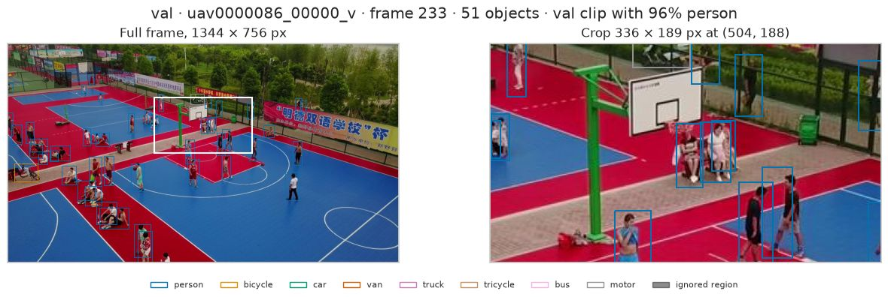
Розподіл класів між val і train різний:
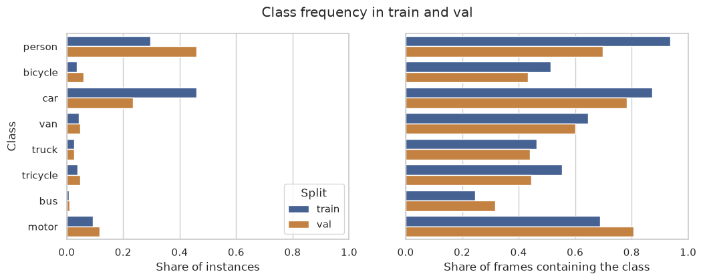

Далі великий вплив мало те, що я вирішив поміняти один кліп з train і кліп з val повністю, бо до обміну $\approx 55\%$ кадрів були ширші за test і bus був тільки у одному кліпі, а після лише 22% та було 2 кліпи з bus (див. [Фінальний вибір](#фінальний-вибір)).

Оцінив, що сусдні кадри дуже схожі бо IoU того само об'єкта в межах 0.87-0.90, звідси вже думки про користь темпоральності та про те що можна брати кроки між кадрами більше за 1 (див. [Стратегії даних](#стратегії-даних), [Temporal rescoring і box smoothing](#temporal-rescoring-і-box-smoothing)).
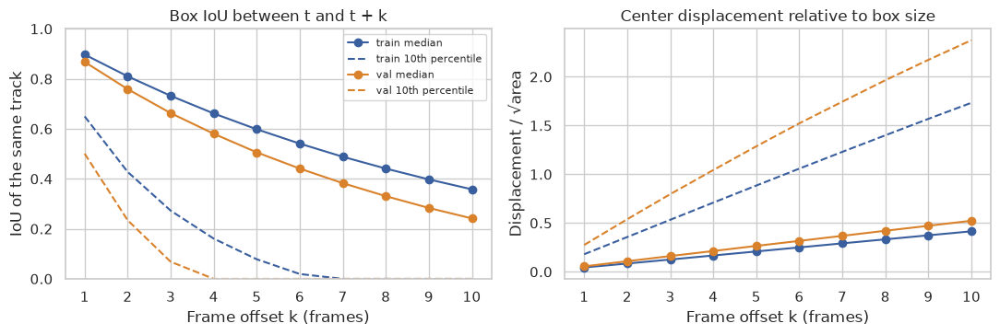

### Тренування бейзлайнів

У загальному брав за основу: 
-   COCO-pretrained weights. Shorter side 1024 px (max_size 1824); YOLO imgsz 1824 дає той самий object scale. Train кадри з кроком 5(економить час та не шкодить скору сильно, див. [Стратегії даних](#стратегії-даних)), близько 1.5 GPU годин на RTX 5070.

Самі бейзлайни старався лишити, якомого простішими для чистоти експериментів:
- torchvision: SGD moment 0.9, сталлий LR, без warmup-у, augmentation, з frozen BatchNorm.
- RT-DETR: adamw optimizer з офіційним RT-DETRv2 recipe підібраний під batch 16, без augmentation, batch 2 * grad accumulation 2 = effective batchsize 4 (див. [RT-DETRv2](#rt-detrv2)).
- YOLO: дефолт Ultralytics, явно задав optimizer adamw на всі ітерації. Ultralytics augmentation лишив увімкненою, бо, вона вбудована у стандартному тренувані framework-а, тому порівняння між сім'ями змішаний з нативною аугментацією yolo.

#### Моделі

| Family | Model | Framework | Optimizer | Epochs | Effective batch | GPU hours | Best epoch |
| --- | --- | --- | --- | --- | --- | --- | --- |
| two-stage anchor-based | Faster R-CNN ResNet50-FPN v2 | torchvision | SGD, LR 0.005 | 10 | 4 | 1.33 | 2 |
| one-stage anchor-based | RetinaNet ResNet50-FPN v2 | torchvision | SGD, LR 0.0025 | 12 | 4 | 1.38 | 4 |
| one-stage anchor-free | YOLO11s | Ultralytics | AdamW, LR 0.000833 | 20 | 64 | 1.12 | 7 |
| query-based | RT-DETRv2 R50vd | Hugging Face | AdamW, LR 1e-4 (backbone 1e-5) | 7 | 4 | 1.43 | 2 |

Для YOLO effective batch 64, бо він акумулює градієнт до номінально 64.

#### Оцінка

Для оцінки був один спільний evaluator(faster-coco-eval), full val - основна метрика, найкращі ваги обираються на основі val mAP[.5:.95](надалі просто mAP), з кроком між кадрам 5. Метрики у таблиці вимірялися з кроком 1.

| Model | mAP | AP50 | AP75 | AP_small | AP_medium | AP_large | mAP ≤ 1920 px | ms/image | Public LB |
| --- | --- | --- | --- | --- | --- | --- | --- | --- | --- |
| Faster R-CNN | 0.3013 | **0.6159** | 0.2630 | 0.1069 | **0.2744** | 0.4635 | 0.2819 | 62.5 | 0.2273 |
| RetinaNet | 0.2689 | 0.5116 | 0.2559 | 0.0780 | 0.2347 | 0.4185 | 0.2631 | 48.6 | 0.1562 |
| YOLO11s | 0.2671 | 0.5242 | 0.2443 | 0.1119 | 0.2483 | 0.3960 | 0.2483 | **13.7** | 0.2097 |
| RT-DETRv2 | **0.3209** | 0.6027 | **0.3056** | **0.1334** | 0.2719 | **0.4861** | **0.2935** | 53.2 | **0.2563** |

Також з процесу тренування було видно, що всі моделі, окрім yolo(яка мала свою аугментацію та спадний lr через що ймовірно відрізнялась) швидко: за 2-4 епохи досягали плато і починали оверфітитися на тренувальні дані, лосс зменшувався, без поліпшення валідаційних результатів. Це вплинуло на рішення спробувати змінювати дані(див. [Стратегії даних](#стратегії-даних)). Ось на цьому графіку видна що rtdetr baseline має пік на 2-3 епосі. Графік: [Стратегії даних](#стратегії-даних).

## Експерименти і тюнінг моделей
### Шум між seeds
Для того аби вибирати чи якась змінна вважається достатньо хорошою я хотів визначити найменше покращення mAP, яку я рахую не просто шумом, а причиною зміни. Для цього я ранив той самий конфіг на іншомі seed-і. Це я робив лише для r-cnn та rt-detr, бо не був впевнений, що покращення спричинені саме зміною, а не шумом.

| Family | Run, seed 42 | Run, seed 7 | mAP, seed 42 | mAP, seed 7 | Seed difference, full val | Seed difference per epoch, mean / max |
| --- | --- | --- | --- | --- | --- | --- |
| Faster R-CNN | `faster_rcnn-baseline` | `faster_rcnn-baseline_5ep-s7` | 0.3013 | 0.3022 | 0.0009 | 0.0054 / 0.0119 (epochs 1 to 5) |
| RT-DETRv2 | `rtdetr-lr_scaled` | `rtdetr-lr_scaled_repeat-s7` | 0.3305 | 0.3211 | **0.0094** | 0.0106 / 0.0229 (epochs 1 to 7) |

Тому результат lr_scaled до batch 4 просто шум і не є успішним (див. [RT-DETRv2](#rt-detrv2)).
### Faster R-CNN

| Experiment | Epochs | mAP | Δ mAP | AP50 | AP_small | Verdict |
| --- | --- | --- | --- | --- | --- | --- |
| `baseline` | 10 | 0.3013 | | 0.6159 | 0.1069 | reference |
| `lr_cosine` | 10 | 0.3062 | +0.0049 | 0.6082 | 0.1225 | within noise |
| `anchors_small` | 5 | 0.3037 | +0.0024 | 0.6183 | 0.1107 | within noise |
| `giou_loss` | 5 | 0.3066 | +0.0053 | 0.6258 | 0.1203 | within noise, kept as tuned |
| `baseline_5ep-s7` | 5 | 0.3022 | +0.0009 | 0.6224 | 0.1161 | noise estimate |

lr_cosine - learning rate зменшується за косинусом від 0.005 до 0 за 10 epochs, без warmup, причиною був дуже швидкий оверфіт. Трохи покращення, але в межах шума, і всеодно максимум на 2 епосі не виправив оверфіт взагалі.

anchors_small - зменшити розмір якорів з 32–512 px до 16–256 px на рівнях P2–P6, бо велика кількість малих об'єктів на яких поганий скор. Це дало proposal recall +4.7 п., detection recall лише +2.6, але скор не збільшився, тобто anchors не є тут bottleneck-ом.

giou_loss - GIoU loss замість Smooth L1 для box regression на second stage (RoI head), вага 10. Гіпотеза - краща локалізація для вищих IoU threshold-ів, з яких складається mAP. AP75 не зріс, отже гіпотеза не підтвердилась. Його потім використовував для порівняння і навіть був членом фінальних ансамблів (див. [Моделювання та ансамбль](#моделювання-та-ансамбль)).
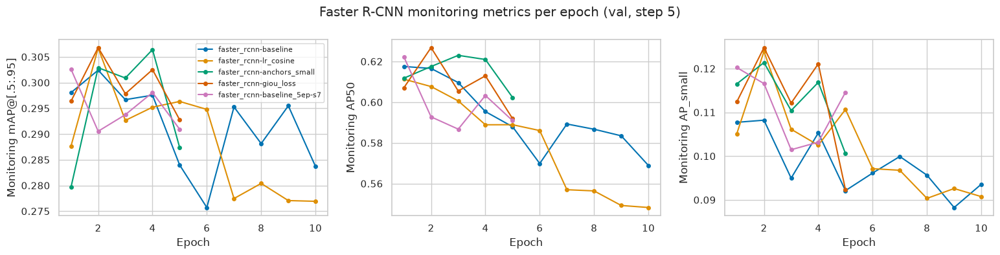

Усі деталі у ноутбуці [`02_two_stage.ipynb`](https://github.com/kerfmanner/object_detection_hw2/blob/main/notebooks/02_two_stage.ipynb).

### RetinaNet

| Experiment | Epochs | mAP | Δ mAP | AP50 | AP_small | Verdict |
| --- | --- | --- | --- | --- | --- | --- |
| `baseline` | 12 | 0.2689 | | 0.5116 | 0.0780 | reference |
| `anchors_eda` | 5 | 0.2271 | −0.0418 | 0.4968 | 0.0766 | worse |
| `focal_loss` | 5 | 0.2671 | −0.0018 | 0.5102 | 0.0807 | worse |

На anchors_eda я зменшив усі якорі на один степінь base sizes 16, 32, 64, 128, 256 px на рівнях P3–P7 замість default 32–512 px причиною для цього було те що об'єкти малі.

Для focal_loss змінив gamma з дефолт значення 2 на 1, це означає, що hard examples мають менше ваги, бо об'єкти у ignored regions, не розмічені і тренуються як фон, тобто стають hard negatives, і думав, що з меншою вагою на hard examples ці хибні негативи будуть шкодити менше.

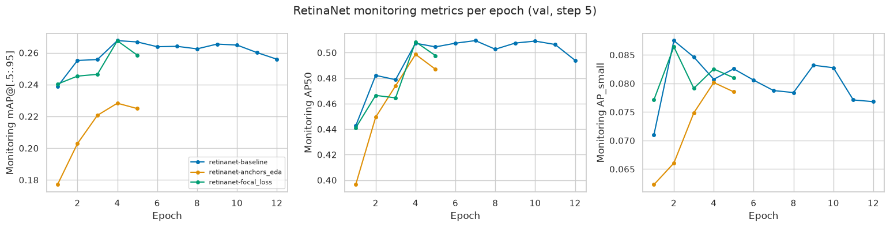

Усі деталі у ноутбуці [`03_one_stage_anchor.ipynb`](https://github.com/kerfmanner/object_detection_hw2/blob/main/notebooks/03_one_stage_anchor.ipynb).

### YOLO11s

| Experiment | Epochs | mAP | Δ mAP | AP50 | AP_small | Verdict |
| --- | --- | --- | --- | --- | --- | --- |
| `baseline` | 20 | 0.2671 | | 0.5242 | 0.1119 | reference |
| `imgsz_1280` | 20 | 0.2498 | −0.0173 | 0.4963 | 0.1119 | worse |
| `tal_topk` | 20 | 0.2671 | 0.0000 | 0.5334 | 0.1146 | no change |
| `scale_025` | 20 | 0.2667 | −0.0004 | 0.5217 | 0.1094 | worse |

imgsz_1280, зміна полягала у тому, що input size 1280 замість 1824, і в training, і в inference. Тут пробував наскільки зменшиться точність і настільки збільшиться швидкість: −0.0173 mAP, але в 1.7 раза швидче, ще потім спробував використати цю модель у ансамблі, як додаткову і отримав невеликий приріст, про це потім (див. [Моделювання та ансамбль](#моделювання-та-ансамбль)).

tal_topk, зміна у тому, що у Task-Aligned Assigner (TAL) topk 20 замість 10. 0.0000 mAP, тобто нічого не змінилось. Ефект перерозподілився: AP_large +0.026 і AP50 +0.009, але AP_medium −0.012.

scale_025, зміна - scale augmentation gain 0.25 замість 0.5, бо при gain 0.5 зменшення в 2 рази робить small objects меншими, ніж може розрізнити stride 8 (найдрібніший рівень YOLO11s). Без покращення.

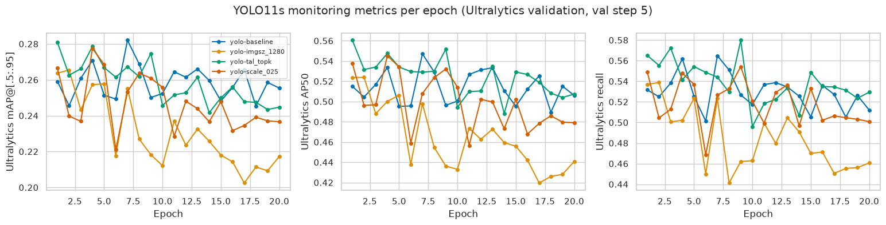

Усі деталі у ноутбуці [`04_anchor_free.ipynb`](https://github.com/kerfmanner/object_detection_hw2/blob/main/notebooks/04_anchor_free.ipynb).

### RT-DETRv2

| Experiment | Epochs | mAP | Δ mAP | AP50 | AP_small | Verdict |
| --- | --- | --- | --- | --- | --- | --- |
| `baseline` | 7 | 0.3209 | | 0.6027 | 0.1334 | reference |
| `lr_scaled` | 7 | 0.3305 | +0.0096 | 0.6140 | 0.1352 | did not repeat |
| `lr_scaled_repeat-s7` | 7 | 0.3211 | +0.0002 | 0.6122 | 0.1293 | within noise |
| `denoising_groups` | 7 | 0.3274 | +0.0065 | 0.6171 | 0.1367 | within noise |

lr_scaled - змінив LR відповідно до різниці між batchsize-ом, для якого тренувався бейзлайн і якій я використовував(16 проти моїх 2*2=4) тобто поділив lr на 16/4 = 4. Приріст залежав від seed-а.

denoising_groups - num_denoising = 200 замість 100, у нашому випадку кадри мають дуже щільно росташовані об'єкти, тому це збільшує кількість груп, які створюються при тому самому batch size. У бейзлайна $59\%$ train batches мали лише 1 групу, тепер  лише $14.7\%$. Результат + 0.0065 mAP у межах шуму. Далі не використовував.

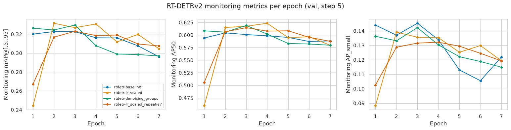

Усі деталі у ноутбуці [`05_query_based.ipynb`](https://github.com/kerfmanner/object_detection_hw2/blob/main/notebooks/05_query_based.ipynb).

### Підсумок тюнінгу
Жодна зміна гіперпараметрів не дала великого виграшу звідси проблема не лише у самих налаштуваннях моделей, а в overfitting на 56 clips. Тому наступний крок це стратегій з даними (augmentation, step 2), і вони вже дали gain вище noise. [Стратегії даних](#стратегії-даних)

## Фінальні пайплайни

### Стратегії даних

Ці зміни я перевіряв на RT-DETRv2 baseline(0.3209 mAP) за тих самих умов.

#### Що спрацювало

- **D1** Аугментація: flip, photometric distortion, multi-scale training 832-1216px. Дало +0.0164 mAP.
- **D2** Step 2: в 2.5 рази більше кадрів, +0.0069 mAp.
- **D1 + D2 = M1**: +0.0193 і +0.0195 на двух різних seed-ах
Це і є фінальний варіант RT-DETR, тепер найцікавіше, що mAP тримається біля піку на всіх епохах до кінця(rtdetr-augment-recipe), тобто overfitting сильно полегшено(виправлено частково)

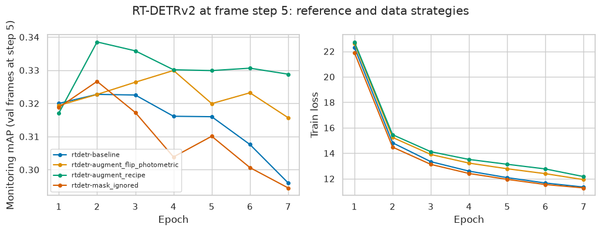

#### Що не спрацювало

| Experiment | Change | Reference | mAP | Δ mAP | Verdict |
| --- | --- | --- | --- | --- | --- |
| `rtdetr-mask_ignored` | ignored regions filled with the train mean colour | `rtdetr-baseline` | 0.3241 | +0.0032 | within noise |
| `rtdetr-ema` | weight EMA | `rtdetr-baseline` | 0.3324 | +0.0115 | one seed, mAP decline remained, not used in final pipeline |
| `faster_rcnn-giou_recipe` | D1 on the tuned Faster R-CNN | `faster_rcnn-giou_loss` | 0.3074 | +0.0008 | within noise |
| `rtdetr-recipe_step2_low_res` | 25% of frames shrunk 2x (idea from test frame sizes) | M1 | 0.3311 | −0.0091 | dropped |
| `rtdetr-infer_trainval_recipe_step2_det500` | M1 trained on train + val (63 clips) | M1, LB 0.2722 | LB 0.2602 | LB −0.0120 | worse on LB |

### Стратегії інференсу

| Experiment | Change | Reference | mAP | Δ mAP | Δ AP_small |
| --- | --- | --- | --- | --- | --- |
| `rtdetr-infer_det500` | 500 detections instead of 300 | `rtdetr-baseline` | 0.3230 | +0.0021 | +0.0006 |
| `rtdetr-infer_size1152` | shorter side 1152 px instead of 1024 | `rtdetr-baseline` | 0.3254 | +0.0045 | +0.0141 |
| `rtdetr-infer_size1280` | shorter side 1280 px | `rtdetr-baseline` | 0.3185 | −0.0024 | +0.0166 |
| `rtdetr-infer_size1408` | shorter side 1408 px | `rtdetr-baseline` | 0.3062 | −0.0147 | +0.0246 |
| `rtdetr-infer_hflip` | flipped frames, model trained without flips | `rtdetr-baseline` | 0.3049 | −0.0160 | −0.0155 |
| `rtdetr-infer_recipe_hflip` | flipped frames, model trained with flips | [D1](#стратегії-даних) | 0.3382 | +0.0009 | −0.0055 |

Див. також: [Моделювання та ансамбль](#моделювання-та-ансамбль), [Temporal rescoring і box smoothing](#temporal-rescoring-і-box-smoothing).
Ті самі ваги інші налаштування inference-у.

500 detection замість 300 у RT-DETR, gain +0.0015 до +0.0021, але безкоштовний тому лишив.

Більший inference size = 1152 px дає 0.0045, більші розміри обмінюють mAP на AP_small(великі об'єкти втрачають більше ніж дають малі).

Flip TTA(фліп на тесті і WBF фліпів назад у один предікшн) - спершу провалився (-0.016), якщо модель тренувати без augmented flips. А от якщо тренувати з flips то зрівнявся з звичайним RT-DETR + [D1](#стратегії-даних), потім RT-DETR + D1 з фліпом на тесті став членом ансамблю (див. [Моделювання та ансамбль](#моделювання-та-ансамбль)).
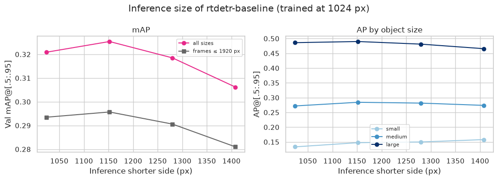

### Моделювання та ансамбль
Навіщо ансамбль - бо різні сім'ї помиляються по-різному.

Як поєднюються prediction-и - WBF, box-и усіх моделей групуються за класами при IoU 0.65 і зливаються у один box, усередненій вагою score-ів.

Як збирав - добавляю по одному члену, якщо хтось збільшував score залишав

Також я побачив, що у мене чомусь на колабі лишилися compute unit-и на колабі, та коли спілкувався зі знайомим то почув, що у них yolo скорить найліпше, тому вирішив взяти іншу більшу YOLO26m-P2, P2 head з stride 4 (див. [YOLO11s](#yolo11s)), тренування on 1088 px клітинках вирізаних з кадрів зі зміненим розміром до 1920 px., SGD з cosine_lr. Результат +0.039 над YOLO11s, напевно потрібно було взяти YOLO11m or YOLO11l та збільшити batch до 4 або 8 і тоді результати було би легше оцінити та і було б більш логічно, але не подумав. З Step 2 training YOLO26m-P2 програв (-0.027), overfit за 2 епохи.

| Ensemble | Members | val mAP | Public LB |
| --- | --- | --- | --- |
| R + F | RT-DETRv2 baseline + Faster R-CNN `giou_loss` | 0.3360 | |
| R + F + Y | + YOLO11s | 0.3533 | |
| B | D1 RT-DETRv2, Faster R-CNN, YOLO11s, YOLO11s at 1280 px, [temporal](#temporal-rescoring-і-box-smoothing) | 0.3755 | 0.2877 |
| D | B + 3 RT-DETRv2 ([M1](#стратегії-даних), M1 seed 7, D1 flipped) + Faster R-CNN `lr_cosine` | 0.3859 | 0.2981 |
| E | D + YOLO26m-P2 | 0.3887 | 0.3235 |
| **F** | E + YOLO26m-P2 at 2304 px | **0.3905** | **0.3397** |
| best single model | RT-DETRv2 M1 with 500 detections | 0.3417 | 0.2722 |

| Family ablation of F | val mAP | Δ mAP |
| --- | --- | --- |
| F (10 members) | 0.3905 | |
| without RT-DETRv2 (4 members) | 0.3718 | −0.0188 |
| without Faster R-CNN (2 members) | 0.3864 | −0.0042 |
| without YOLO11s (2 members) | 0.3863 | −0.0043 |
| without YOLO26m-P2 (2 members, = D) | 0.3859 | −0.0046 |

Фінальний ансамблб F це WBF з 10 prediction-ів з 8 чекпойнтів моделей з 4 різних сімей з темпоральним prediction-ом (див. [Temporal rescoring і box smoothing](#temporal-rescoring-і-box-smoothing)), val 0.3905 та LB 0.3397, найкраща соло модель давала val 0.3417 та LB 0.2722. Основою ансамбля є RT-DETRv2 без нього -0.0188 val mAP, інші сім'ї добавляють по 0.004-0.005 кожна сім'я.

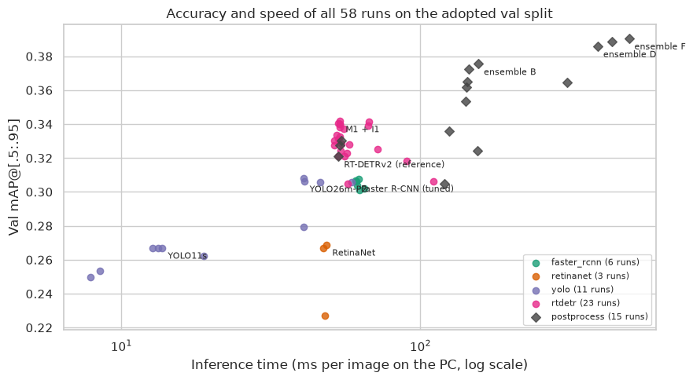

### Внесок кожної зміни

| Step | Kind of change | val mAP | Δ mAP |
| --- | --- | --- | --- |
| RT-DETRv2 baseline | reference | 0.3209 | |
| + D1 + D2 (M1) | [data](#стратегії-даних) | 0.3402 | +0.0193 |
| + 500 detections | [inference](#стратегії-інференсу) | 0.3417 | +0.0015 |
| + temporal rescoring and smoothing | [inference](#temporal-rescoring-і-box-smoothing) | 0.3478 | +0.0061 |
| ensemble F without temporal (instead of the previous row) | [modelling](#моделювання-та-ансамбль) | 0.3804 | +0.0387 over M1 + 500 detections |
| **ensemble F** | + temporal | **0.3905** | +0.0102 |

Найбільше дає ансамбль (+0.039), удвічі більше за дані (+0.019). Inference-трюки дають найменше: 500 detections +0.0015. Сумарно від baseline до F: +0.0696 mAP. Temporal прациє ліпше на ансамблі ніж на одній моделі +0.010 проти +0.006.

Заранив Сross Validation для rt-detr і ансамблю RT-DETR M1 і Faster R-CNN. Вийшло, що ансамбль кращий за RT-DETR на всіх 3 folds, від +0.013 до +0.027. Але std=0.036 між фолдами тому просто довіряти просто валідації на 7 val не дуже надійно.

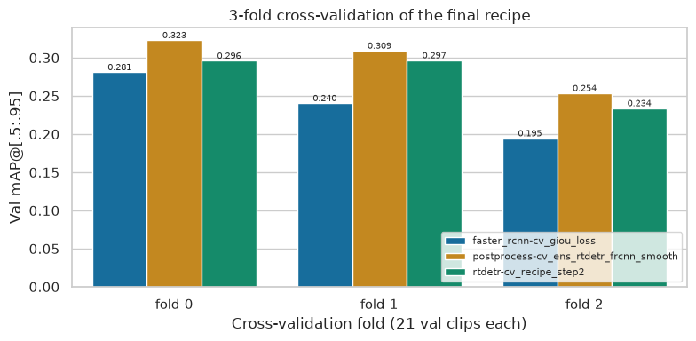

### Фінальний вибір
Два фінальні submissions на Kaggle, вибір заргументований лише val mAP:

- F, найкращий на val: 0.3905, LB 0.3397.
- D як підстраховка: це F без двох members YOLO26m-P2 (val 0.3859, LB 0.2981).

Ось графік на якому зображить усі мої забмішини на public LB.
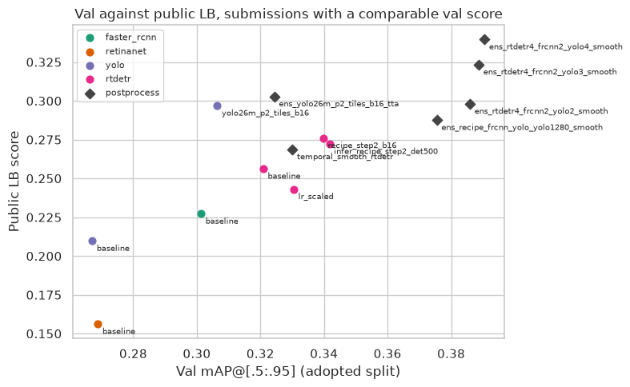

Усі деталі у ноутбуці [`06_final_pipeline.ipynb`](https://github.com/kerfmanner/object_detection_hw2/blob/main/notebooks/06_final_pipeline.ipynb).

## Візуалізація RT-DETRv2 (бонус)

Всі рани логувалися на WandB ось посилання на [WandB проект](https://forge.coreweave.com/wandb/konovalov-pn-ukrainian-catholic-university/visdrone-hw2).

Я спробував візуалізувати RT-DETRv2(M1) 263 val frames:
- t-SNE query embeddings з останнього декодер лейеру. RT-DETR має 300 queries і після останнього декодер шарі це вектор на 256 чисел з цього вектора class head передбачає клас, а box head передбачає box, цей 256-д простір стискаємо до 50 вимірів використовуючи PCA, а потім t-SNE до 2D, чому не зразу t-SNE, бо дуже важко по compute-у.
  
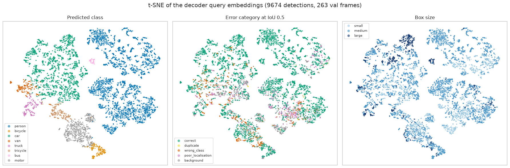

- deformable cross-attention кожного query по шарах. RT-DETR використовує deformable attention: кожна query на кожному декодер шарі дивиться лише у декілька точок feature maps, кожну з певною вагою на трьох рівнях stride 8, 16, 32), через forward hooks на attention-модулях декодера записано ці точки і ваги під час звичайного forward pass. Потім координати переведено назад у пікселі картинки.

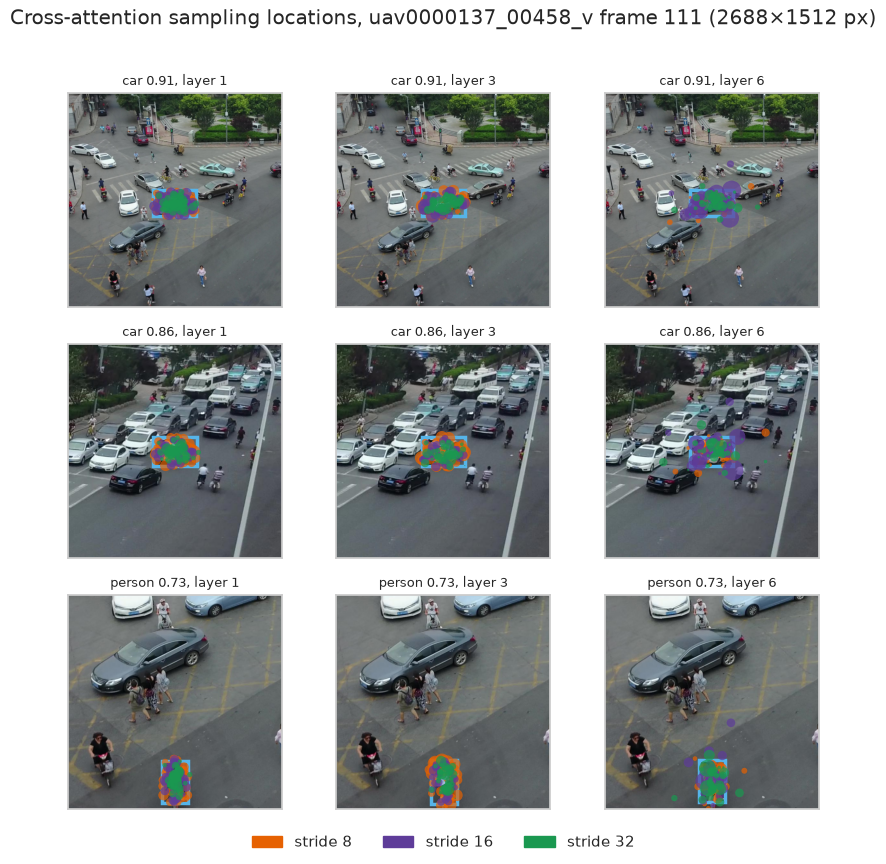

Усі деталі у ноутбуці [`07_bonus_visualization.ipynb`](https://github.com/kerfmanner/object_detection_hw2/blob/main/notebooks/07_bonus_visualization.ipynb).

## Використання темпоральності(бонус).

Вирішив це зробити, бо сусідні кадри майже не відризняються (див. [Дані](#дані)) і було додаткове на цю тему.

### Temporal rescoring і box smoothing

Метод у три кроки(ідею взяв у Seq-NMS):
1. Лінкування: detections одного класу у кадрі k i k+1 жадібно зв'язуються один-до-одного за певного IoU, з них утворюється track
2. Rescoring: $$s_{new} = (1 - w) \cdot s + w \cdot \mathrm{stat}(\text{track})$$
де $w$ - Weight, $\mathrm{stat}$ - статистика для вибору відновлення(mean or max).

3. Box smoothing. Box, що має сусідів з обої боків стає:$$b_{new} = \frac{b_{t-1} + 2 b_t + b_{t+1}}{4} \quad \text{(offline)}, \qquad b_{new} = \frac{b_{t-1} + 2 b_t}{3} \quad \text{(causal)}$$

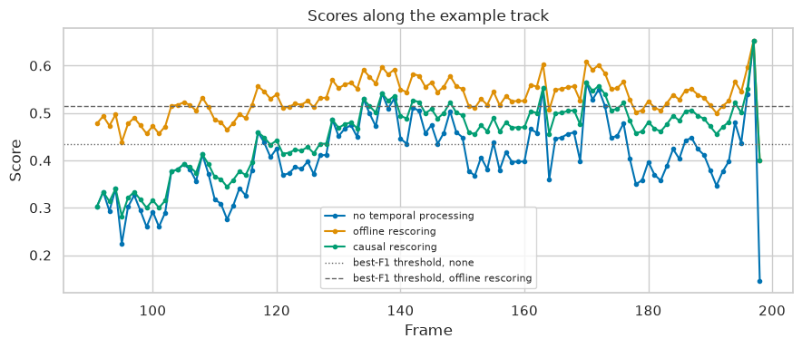

#### Результати

Див. також: [Внесок кожної зміни](#внесок-кожної-зміни), [Стратегії інференсу](#стратегії-інференсу).

| Mode | Track statistic | Weight | Link IoU | Box smoothing | mAP | Δ mAP | Δ half A | Δ half B |
| --- | --- | --- | --- | --- | --- | --- | --- | --- |
| none | | | | | 0.3209 | | | |
| offline | mean | 0.5 | 0.3 | no | 0.3242 | +0.0033 | +0.0084 | +0.0008 |
| offline | max | 0.25 | 0.3 | no | 0.3260 | +0.0051 | +0.0033 | +0.0051 |
| offline | max | 0.5 | 0.3 | no | 0.3276 | +0.0068 | +0.0037 | +0.0084 |
| offline | max | 0.75 | 0.3 | no | 0.3231 | +0.0023 | −0.0005 | +0.0065 |
| offline | max | 1.0 | 0.3 | no | 0.2900 | −0.0309 | −0.0314 | −0.0179 |
| offline | max | 0.5 | 0.5 | no | 0.3274 | +0.0066 | +0.0040 | +0.0083 |
| offline | max | 0.5 | 0.7 | no | 0.3262 | +0.0053 | +0.0043 | +0.0055 |
| **offline** | **max** | **0.5** | **0.3** | **yes** | **0.3301** | **+0.0092** | **+0.0058** | **+0.0107** |
| causal | mean | 0.5 | 0.3 | no | 0.3230 | +0.0021 | +0.0065 | −0.0030 |
| causal | max | 0.5 | 0.3 | no | 0.3253 | +0.0045 | +0.0024 | +0.0062 |
| causal | max | 0.5 | 0.3 | causal | 0.3120 | −0.0089 | −0.0108 | −0.0048 |

Offline - дивимся track у дві сторони. Causal - тільки у минуле.

Усі деталі у ноутбуці [`07_bonus_temporality.ipynb`](https://github.com/kerfmanner/object_detection_hw2/blob/main/notebooks/07_bonus_temporality.ipynb).

## Підсумок

1. Найбільшив внесок ансамбль.
2. Велика проблема overfitting і маленькі об'єкти.
3. Різниця між роздільністю кадрів test, train, val добавляє складності і bias-у.
4. Темпоральність найбільш неочікуваний виграш.